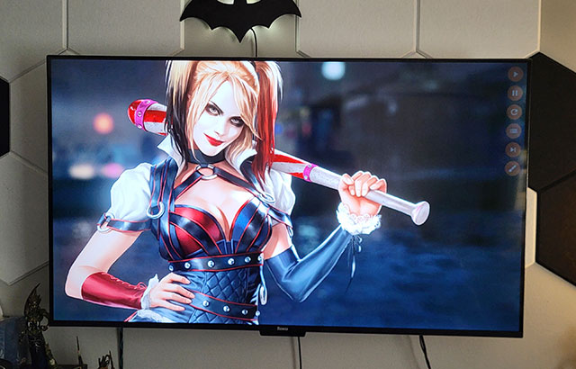

# Digital Picture Viewer

A slideshow app for showing your own photo collection on a large TV or display, at the interval you choose.

I have a lot of images stored and wanted to show them on a big screen with my own timing, and I couldn't find anything free that did it. This project was also my first step into the Electron world.



More screenshots are in [src/assets](src/assets).

## Features

**Slideshow**
- **Image groups**: organise folders into groups (e.g. "Holidays", "Wallpaper") and switch between them from the slideshow. Subfolders can be included per folder.
- **Interval**: choose how long each image is shown, in seconds or minutes.
- **Order**: by name or date modified, in either direction.
- **Transitions**: fade, fade through black, slide left, slide up, zoom, wipe or random. They play when the interval is longer than 10 seconds.
- **Formats**: jpg, png, gif, webp and bmp.

**Display**
- **Fill the screen**: crop images to fill the screen, keeping the top, the center, or the faces and main subject in view.
- **Smart focus**: finds the faces (or the main subject when there are none) in each image. Runs offline, and results are cached.
- **Fit mode**: when not filling the screen, images are fitted to the height. The space around them can show a faded copy of the image, and the background color is configurable.

**Controls**
- Move the mouse or press a key to show the controls: previous, play/pause, next, up next, image groups, preferences and full screen. They hide again after a few seconds, along with the cursor.
- **Up next**: see the remaining images, jump to one, or remove it from the play list.
- **Light/dark**: preferences follow the Windows light/dark setting, or can be set to light or dark.
- **Keeps the screen on**: the display won't go to sleep while the app is running.

## Keyboard shortcuts

| Key | Action |
|---|---|
| Space | Play / pause |
| → / ← | Next / previous image |
| F or F11 | Toggle full screen |
| Esc | Close the up next list, or leave full screen |
| F1 / F2 / F3 | Play / pause / next |

## Install

Download **digital-picture-x.x.x.Setup.exe** from the [latest release](https://github.com/Evangaline/e-masque-digital-viewer/releases/latest) and run it. It installs the app and adds Start menu and desktop shortcuts.

The installer isn't code-signed, so Windows may show "Windows protected your PC". Click **More info**, then **Run anyway**.

Settings are saved automatically in `%APPDATA%\digital-picture\`:

| File | Contents |
|---|---|
| `digital-picture-preferences.json` | Preferences, groups and the current play list |
| `digital-picture-focus.json` | Smart focus cache. Safe to delete; it's rebuilt as images are shown |

## Development

### Requirements

- **Node.js 24 LTS.** Angular 22 needs Node 22.22.3 or later, and Node 26 isn't supported for packaging yet (`npm run make` stops part way through without an error). With nvm:

  ```bash
  nvm install 24
  nvm use 24
  ```

- Built with Angular 22, Angular Material 22 and Electron 44.

### Run

```bash
npm install
npm run electron-build
```

### Test

```bash
npm test
```

### Build the installer

```bash
npm run make
```

This builds the Angular app, then the Windows installer in `out\make\squirrel.windows\x64\`.

Delete the `out` folder before each build. If you see this error:

```
This is a dummy update.exe.  If you are seeing this, your build did not correctly replace the IDR_UPDATE_ZIP resource.
```

the `out` folder probably wasn't deleted first, and the exe ended up too big.

## Credits

- Face detection: [MediaPipe](https://ai.google.dev/edge/mediapipe) (Apache 2.0), BlazeFace short range model.
- Subject detection: [smartcrop.js](https://github.com/jwagner/smartcrop.js) (MIT).

## License

This software is for non-commercial use only. For commercial use, please get in touch. See [LICENSE](LICENSE) for details.

## Author

Created by Nick Coleman in 2025.
